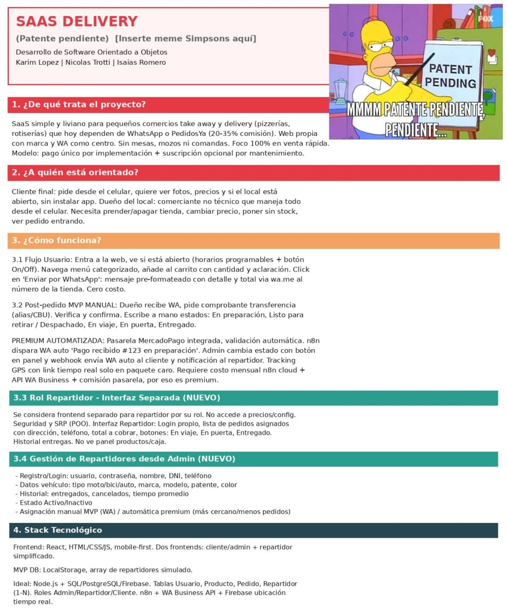
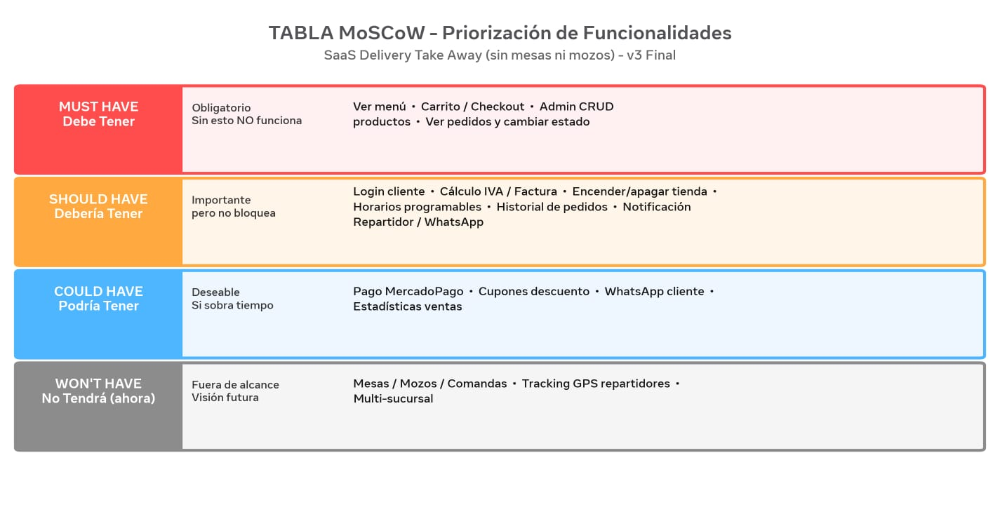
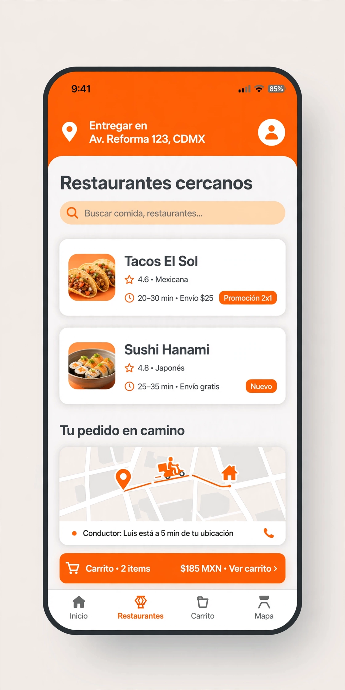

# 🛵 AppDelivery MVP


> MVP de plataforma de delivery para conectar clientes, comercios y repartidores. Proyecto académico enfocado en validar el flujo completo de un pedido.


### 📑 Documentación visual del proyecto



### 📋 2. Priorización MoSCoW



### 📸 1. Preview de la App

<!-- REEMPLAZAR RUTA CUANDO SUBAN LA IMAGEN -->



## 🎯 Objetivo del MVP

Crear un flujo mínimo y funcional donde un cliente pueda hacer un pedido, el comercio lo reciba y se notifique por WhatsApp, sin depender de plataformas con altas comisiones.

## ✨ Funcionalidades (Alcance MVP)

- **Cliente:** Ver catálogo, armar carrito y enviar pedido.
- **Comercio:** Recibir pedido y cambiar estado (Pendiente / En preparación / Listo) manual via whats app.

## 🛠️ Tech Stack

**Frontend:**
- HTML5
- CSS3
- JavaScript (Vanilla)

**Backend:**
- JavaScript
- Base de datos: MariaDB

**Otros:**
- WhatsApp API para envio de formularios

## 📁 Estructura del Proyecto

```bash
/appdelivery-mvp
├── /docs
│ └── /images
├──  index.html
├──  admin.html
├──  css
│ └── /index.css
│ └── /slideCart.css
├──  js
│ └── /admin.js
│ └── /idex.js
│ └── /slideCart.js
├── /backend
│ ├── src/
│ └── db/
└── README.md
## 🚀 Cómo correr el proyecto local

1. Clonar
git clone https://github.com/Isa696/AppDeliveryMvp.git

4. Frontend
Abrir `index.html` con Live Server o abrir directo en el navegador.

---

## 👥 Integrantes

- *Lautaro Karim Lopez*
- *Nicolas Trotti*
- *Isaias Romero*

## 🗺️ Próximos Pasos

- Mockups y presentación
- [ ] Conexión Frontend - Backend
- [ ] Integración MariaDB
- [ ] Integración WhatsApp API